<div align="center">


**A multi-class YOLOv8 object detection model for road scenes, built from recorded road videos.**

[Overview](#overview) · [Pipeline](#pipeline) · [Classes](#classes) · [Getting Started](#getting-started) · [Training](#training) · [Project Status](#project-status)

</div>

---

## Overview

This project prepares a dataset and trains a YOLOv8 model that detects road-safety objects: potholes, vehicles by type, road line types, people, pedestrian lanes, rumble strips, traffic lights, and crossing cones. It was built as a Data Science final project.

## Pipeline

```mermaid
flowchart LR
    V[Road videos<br/>720p] --> E[Extract frames<br/>1 fps, 640x640]
    E --> F[Filter blurry<br/>and dark frames]
    F --> S[Split<br/>70 / 20 / 10]
    S --> A[Annotate<br/>YOLO format]
    A --> C[Check class<br/>balance]
    C --> T[Train YOLOv8<br/>on Kaggle]

    style V fill:#0D1117,stroke:#30363D,color:#C9D1D9
    style E fill:#0D1117,stroke:#1F6FEB,color:#C9D1D9
    style F fill:#0D1117,stroke:#1F6FEB,color:#C9D1D9
    style S fill:#0D1117,stroke:#1F6FEB,color:#C9D1D9
    style A fill:#0D1117,stroke:#D29922,color:#C9D1D9
    style C fill:#0D1117,stroke:#1F6FEB,color:#C9D1D9
    style T fill:#0D1117,stroke:#2EA44F,color:#C9D1D9
```



| Step | Script | What it does |
|---|---|---|
| 1 | `scripts/01_extract_frames.py` | Extracts 1 frame per second from each video, resized to 640x640 JPEG (quality 85) |
| 2 | `scripts/02_filter_blurry.py` | Moves blurry or dark frames to `rejected_frames/` (`BLUR_THRESHOLD`, default 50) |
| 3 | `scripts/03_split_dataset.py` | Shuffles with a fixed seed (42) and splits into train, val, and test |
| 4 | Manual | Annotate bounding boxes in Roboflow, LabelImg, or CVAT and export in YOLO format |
| 5 | `scripts/04_class_stats.py` | Reports class distribution to find imbalanced classes |

## Classes

| ID | Class | ID | Class |
|---|---|---|---|
| 0 | pothole | 7 | cone |
| 1 | car | 8 | pedestrian_lane |
| 2 | truck | 9 | road_line_solid |
| 3 | motorcycle | 10 | road_line_broken |
| 4 | bus | 11 | road_line_double_yellow |
| 5 | person | 12 | rumble_strip |
| 6 | traffic_light | | |

Each label file has one line per object, with values normalized from 0 to 1:

```text
<class_id> <x_center> <y_center> <width> <height>
```

## Project Structure

```text
Data_Sci_Final/
├── Raw_Data/            # Original videos (do not modify)
├── scripts/             # Data preparation pipeline (steps 1 to 4)
├── extracted_frames/    # Generated: raw frames per video
├── clean_frames/        # Generated: frames that passed the quality filter
├── rejected_frames/     # Generated: blurry or dark frames for review
└── dataset/             # Final YOLO-ready dataset
    ├── dataset.yaml     # Class names and paths
    ├── images/          # train / val / test
    └── labels/          # train / val / test
```

## Getting Started

```bash
pip install opencv-python-headless
python scripts/01_extract_frames.py
python scripts/02_filter_blurry.py
python scripts/03_split_dataset.py
# annotate the images, then:
python scripts/04_class_stats.py
```

## Training

After annotation, zip and upload `dataset/` to Kaggle:

```python
!pip install ultralytics
from ultralytics import YOLO

model = YOLO('yolov8n.pt')
model.train(
    data='/kaggle/input/your-dataset/dataset.yaml',
    epochs=100,
    imgsz=640,
    batch=16,
    device=0,
    project='/kaggle/working/runs'
)
```

## Project Status

Dataset preparation. This repository currently holds the project documentation. The scripts, videos, and dataset described above are not committed here yet.

---

<div align="center">
<sub>Part of the <a href="https://github.com/nixxinix">nixxinix</a> project portfolio</sub>
</div>
